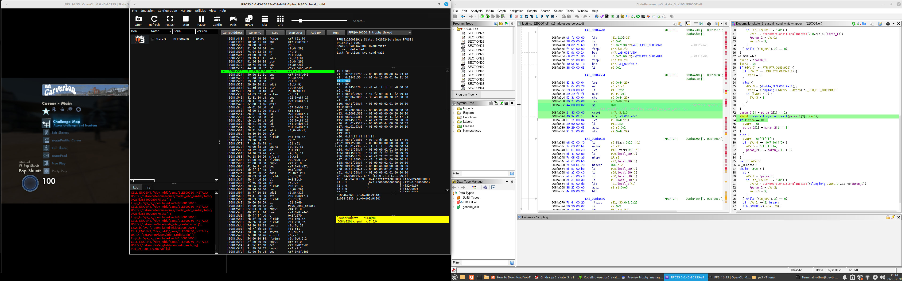

# Session 2026-10-20

Session 2026-10-13 produced many inferences about the trophy worker thread, based on AI-assisted static analysis. This session validates those findings, this time at runtime with the RPCS3 debugger.

The RPCS3 patches created in the previous session sped up debugging immensely and made this validation practical.

The trophy worker thread is the only place that calls `sceNpTrophyUnlockTrophy`. The goal now is to find out where work is added for it and how it is woken up to unlock a trophy on the PS3.

## Trophy Worker Thread - Wakeup Mechanism

In the RPCS3 debugger, the trophy worker thread (`0x004bdb60`) was seen sleeping at `0x008fa51c`.
This is the `sc` instruction for `sys_cond_wait` inside `FUN_008fa40c`.

### Threads Wakes up by Signal

A breakpoint at `0x008fa520` catches the wakeup. This is the instruction immediately after the `sc` (the `sys_cond_wait` syscall) at `0x008fa51c`.
It executes the moment the worker wakes up, before anything else runs.
At that point `r3` holds the syscall return code.

Steps taken:

- I tried to earn the Mantastic Voyage trophy and paused the game just before landing the trick.
- I then set the breakpoint at `0x008fa520`.
- When the worker woke, the breakpoint hit and showed `r3 = 0x0`.

A `sys_cond_wait` return code of 0 means the thread was woken by `sys_cond_signal` (or `sys_cond_signal_all`), not by a timeout.
The screenshot below shows the trophy worker thread hitting the breakpoint with `r3 = 0`, which proves this.



### Finding the condvar Handle

The next question is which code calls `sys_cond_signal` on the trophy worker's condvar. The handle is stored at `ctx + 0x34 + 0x8` (i.e. `ctx + 0x3c`). To find the signaller, the cleanest approach is to read the actual condvar handle value at runtime and then watch for it.

With the worker paused at `0x008fa51c` (inside `sys_cond_wait`), `r28` is the base of the condvar struct (`r28 = 0x41f208e4`). The LV2 condvar handle is the 32-bit value at `r28 + 0x8`, which the code loads at `0x008fa518` with `lwz r3, 0x8(r28)`:

```
handle = *(r28 + 0x8) = *(0x41f208ec)
```

Debugger view of `r28`:
```
r28: 0x41f208e4 -> 00 00 00 02 01 00 00 00
```

Reading `r28 + 0x8` in the RPCS3 memory viewer gives the condvar handle `0x86049400`.

### Finding the Signal Caller

#### Breakpoint on the Signal Call and Compare the Handle

All `sys_cond_signal` calls in the binary go through `FUN_008f8c58`. A breakpoint at `0x008f8cd8` (the `syscall_sys_cond_signal` call inside `FUN_008f8c58`) fires on every signal. Each time it fires, check `r3`, which is the condvar handle being signalled. If `r3` equals the condvar handle found earlier (`0x86049400`), this is the call that wakes the trophy worker. The call stack at that moment shows the caller, which directly reveals which function signals the trophy worker's condvar.

#### Result

The breakpoint fired with `r3` matching the trophy worker's condvar handle from thread `PPU[0x1000004] themain_thread`:

```
PPU[0x1000004]; State: 0x20204[w|mem|PAUSE]
Priority: 1000
Stack: 0xd0049000..0xd0068fff
Joiner: detached
Last function: sys_mutex_lock

r0 : 0x20000000 -> 00 00 00 00 00 00 00 00
r1 : 0xd0068630 -> 00 00 00 00 d0 06 86 c0
r2 : 0x1842b50  -> 01 4e 11 40 01 4e 11 60
r3 : 0x86049400
...
LR: 0x4acd48
...
```

The call site is at `0x004acd44` (`bl 0x008f8c58`) inside `_opd_FUN_004acbc8` and `r2 = 0x1842b50` is the TOC base of the calling thread.

The screenshot below shows the state at the breakpoint:


## Trophy Worker Thread - Signalling Function

The previous steps showed that the trophy worker thread is woken by `_opd_FUN_004acbc8` which is called from a different thread (`themain_thread`). The goal is to find the origin of where the Mantastic Voyage trophy conditions are evaluated and how this signalling function is called.

### Breakpoint

To see which trophy is being enqueued, set a breakpoint at `0x004acd44` (the `bl 0x008f8c58` inside `_opd_FUN_004acbc8`) and trigger a trophy. At that point `r30` holds the trophy ID.

### Result

State of `PPU[0x1000004] themain_thread` at the breakpoint:
```
...
r30: 0xc
...
LR: 0x4acd00
...
```

`r30 = 0xc` is the trophy ID of Mantastic Voyage. The screenshot below shows the state at the breakpoint:


The trophy ID is also visible at the function entry, so it can be followed from entry to signal call:

| Breakpoint | Register | Value | Meaning |
|---|---|---|---|
| `0x004acbc8` (function entry) | `r4` | `0xc` | `param_2` = trophy ID = Mantastic Voyage |
| `0x004acd44` (signal call) | `r30` | `0xc` | trophy ID still `0xc` at point of signal |

### Signalling Function Pseudo-Code

```c
undefined4 _opd_FUN_004acbc8(int *param_1, int param_2 /*trophy ID*/)
{
    // 1. Shutdown guard: ctx+0x5948 — drop if manager shutting down
    if (*(char *)(param_1 + 0x5948) == '\0') return 0;

    // 2. Pre-enqueue gate: vtable call (*param_1->vtable[0x30])(param_1, trophy ID)
    //    Returns 0 if trophy already in local unlock bitset → drop
    if (vtable[0x30](param_1, param_2) != 0) return 0;

    // 3. Lock queue mutex at ctx+0xb
    sys_mutex_lock(param_1 + 0xb);

    // 4. Dedup scan: walk pending queue at ctx+0x14
    //    If trophy ID already queued → skip enqueue, just unlock and return
    if (already_queued(param_1 + 0x14, param_2)) {
        sys_mutex_unlock(param_1 + 0xb);
        return 1;
    }

    // 5. Allocate 12-byte node from pool at ctx+0x17
    node = alloc(param_1 + 0x17, 0xc, 4, 0);
    node[2] = param_2;              // ← trophy ID stored at word [2]

    // 6. Link node into tail of queue at ctx+0x14/0x15, increment count at ctx+0x16

    // 7. Signal the worker
    sys_cond_signal(param_1 + 0x34); // ← wakes TrophyManager_WorkerThread

    // 8. Unlock mutex
    sys_mutex_unlock(param_1 + 0xb);
    return 1;
}
```


# TODO
## Traversing the Call Stack

### Vtable thunk

`_opd_FUN_004acbc8` is registered in the trophy manager vtable at `0x017adfd4`
(`+0x14` from vtable base `0x017adfc0`). It is called through a thunk:

```c
// _opd_FUN_01190130 @ 0x01190130
void _opd_FUN_01190130(longlong param_1) {
    _opd_FUN_004acbc8(param_1 + -8);  // adjust this ptr by -8
}
```

### Indirect dispatch wrapper

`FUN_004a2e70` (`0x004a2e70`) is the intermediate dispatcher:

```c
undefined1 FUN_004a2e70(undefined4 param_1, undefined4 param_2) {
    piVar1 = (*global_singleton->vtable[0x28])(global_singleton); // get trophy mgr
    if (piVar1 != NULL)
        return piVar1->vtable[0x8](piVar1, param_1, param_2);     // → _opd_FUN_004acbc8
    return 0;
}
```

### Central trophy request function

`FUN_004b11d4` (`skate3_themain_thread_trigger_trophy_parent`) is called from **21
places** across the codebase. It is the single public entry point for all trophy
unlock requests:

```c
undefined1 FUN_004b11d4(undefined8 param_1 /*trophy_hash*/, undefined4 param_2) {
    // Look up trophy definition by 64-bit hash
    // Check enable flag
    // Resolve numeric trophy ID via FUN_004b10a0
    // Call FUN_004a2e70(trophy ID, param_2)
}
```

### Trick line evaluator caller

`FUN_00500734` (`0x00500734`) is the trick line evaluation function that calls
`FUN_004b11d4` for Mantastic Voyage. Confirmed via `LR = 0x500948` at breakpoint.

It checks `*(char *)(piVar3 + 0x167e) > 2` — the manual count in the player/trick
state struct must exceed 2 (i.e. 3+ manuals in a line) before dispatching:

```c
if (('\x02' < *(char *)((int)piVar3 + 0x167e)) &&
   (FUN_004b12ec(0x1bd48906e119a954) == '\0')) {
    skate3_themain_thread_trigger_trophy_parent(0x1bd48906e119a954, 0);
}
```

Other trophies evaluated in the same function:
- `0xb598d5bd5d16ec4f` — score > 9,999
- `0x2a9d5f12bc41ee19` — score > 29,999
- `0xe9c379e93fa2693f` — trick count > 2
- `0xd127d95b8d349b72` — float threshold (grind length / speed)
- `0x1bd48906e119a954` — **Mantastic Voyage** (3+ manuals)


---

# Yvo's Notes

Continue further up the call stack

The vtable base has no code xrefs — it's only ever written into an object at construction time via TOC-relative lis/ori. The call to _opd_FUN_004acbc8 through the vtable cannot be traced statically this way.

The most direct approach from here is the live debugger. Set a breakpoint at 0x004acbc8 and look at LR when it fires — that gives the exact call site that dispatched through the vtable to reach this function.

LR: 0x4a2ef4

LR = 0x4a2ef4 — so the call site is at 0x4a2ef0 (LR - 4). Let me look up what function that's in:

FUN_004a2e70 is the nearest function start below 0x004a2ef0. Let me decompile it:

This is a vtable dispatch wrapper. It:

Loads a global object via PTR_PTR_0182cd58 (a global singleton pointer)
Calls vtable[0x28] on it to get another object (piVar1)
Calls piVar1->vtable[0x8](piVar1, param_1, param_2) — passing param_1 and param_2 through
The call at 0x004a2ef0 (LR - 4 = 0x4a2ef4 - 4) is inside this function — piVar1->vtable[0x8] resolving to _opd_FUN_004acbc8. So param_1 here maps to the trophy manager ctx and param_2 is the trophy ID.

This function is the indirect caller — it routes through a global singleton's vtable to reach the enqueue function. Let me check what calls FUN_004a2e70:


FUN_004b11d4 is called from 21 places across the codebase. This is the central trophy unlock dispatch function — the single named point that all game systems call to request a trophy unlock. It:

Looks up the trophy definition by a 64-bit hash key (0x9cb9012080f727b9)
Checks an enable flag (*pcVar2 != '\0')
Resolves the trophy ID via FUN_004b10a0(param_1)
Calls FUN_004a2e70(trophy ID, param_2) → vtable → _opd_FUN_004acbc8 → sys_cond_signal → wakes worker
This is the function to set your breakpoint on for any trophy unlock. param_2 passed to it is likely a context or flags argument; the trophy ID is resolved internally from param_1 (a trophy hash/identifier). Rename this as TrophyManager_RequestUnlock — it's the real public entry point.

=====

i have a breakpoint at FUN_004b11d4, anything to inspect ?

Yes. At the entry of FUN_004b11d4, inspect:

r3 — param_1, the trophy identifier passed in. This is a 64-bit hash or handle that the function uses to look up the trophy definition. Note the value — it will tell us which trophy lookup key maps to Mantastic Voyage, and later which one maps to Gone Viral.

r4 — param_2, the second argument. Unknown purpose so far — could be a context pointer, flags, or player index.

LR — the return address, which tells us which of the 21 callers triggered this for Mantastic Voyage.

Those three values together will tell us what the caller passed in and which code path triggered the unlock.

```
r0 : 0x50091c   -> nop
r1 : 0xd00687f0 -> 00 00 00 00 d0 06 88 b0
r2 : 0x1842b50  -> 01 4e 11 40 01 4e 11 60
r3 : 0x1bd48906e119a954
r4 : 0x0
r5 : 0x0
r6 : 0x2
r7 : 0xffffffffffffffff
r8 : 0x30903000 -> 40 42 d2 f9 6c 4e 4b 8c
r9 : 0x30978ec4 -> 00 00 00 01 00 02 00 02
r10: 0x17fd7a0  -> func(at=0x1189f74, toc=0x1842b50)
r11: 0x2
r12: 0x24004042
r13: 0x10007be0 -> 00 00 00 00 00 00 00 00
r14: 0x0
r15: 0x0
r16: 0x0
r17: 0x0
r18: 0x0
r19: 0x0
r20: 0x0
r21: 0x0
r22: 0xffffffffffffffff
r23: 0x20000000 -> 00 00 00 00 00 00 00 00
r24: 0x55
r25: 0x4
r26: 0x55
r27: 0x30051d20 -> 01 7b 06 b0 00 00 00 00
r28: 0x30073f20 -> 01 79 6e 48 00 00 00 04
r29: 0x3002f7c0 -> 01 79 6b d0 00 00 00 0d
r30: 0x3061e290 -> 30 32 02 a0 30 02 7b e0
r31: 0x0
CR: 0x24004042, CR7: [LT=0 GT=0 EQ=1 SO=0]
...
LR: 0x500948
...
```


## Complete Verified Call Chain (Mantastic Voyage)

```
FUN_00500734 / skate3_evaluate_trick_line
  │  condition: player manual count at struct+0x167e > 2
  │  hash: 0x1bd48906e119a954
  │  r3 = 0x1bd48906e119a954  (confirmed at breakpoint)
  │  r4 = 0x0
  │
  ▼
FUN_004b11d4 / skate3_themain_thread_trigger_trophy_parent
  │  r3 = 0x1bd48906e119a954  (confirmed at breakpoint)
  │  r4 = 0x0
  │  resolves hash → trophy ID = 0xc
  │
  ▼
FUN_004a2e70
  │  routes through global singleton vtable
  │
  ▼
_opd_FUN_004acbc8 (0x004acbc8)
  │  r4 = 0xc  (confirmed at breakpoint: param_2 = trophy ID)
  │  allocates node, writes node[2] = 0xc
  │  r30 = 0xc at signal call (confirmed at 0x004acd44)
  │  sys_cond_signal(ctx + 0x34)
  │
  ▼
TrophyManager_WorkerThread (0x004bdb60)
  │  r3 = 0x0 at 0x008fa520 (confirmed: woken by signal)
  │  dequeues node, reads uVar16 = node[2] = 0xc
  │
  ▼
sceNpTrophyUnlockTrophy(ctx+0x10, ctx+0x14, 0xc, &platflag)
  │  r5 = 0xc  (confirmed at 0x0144cec4 breakpoint)
  │
  ▼
  Trophy unlocked in PS3 system
```
