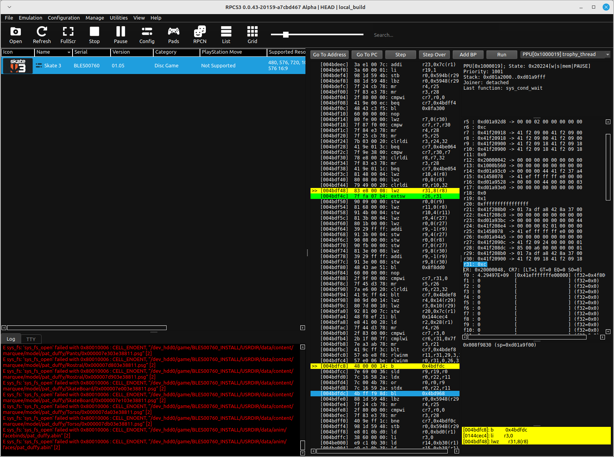
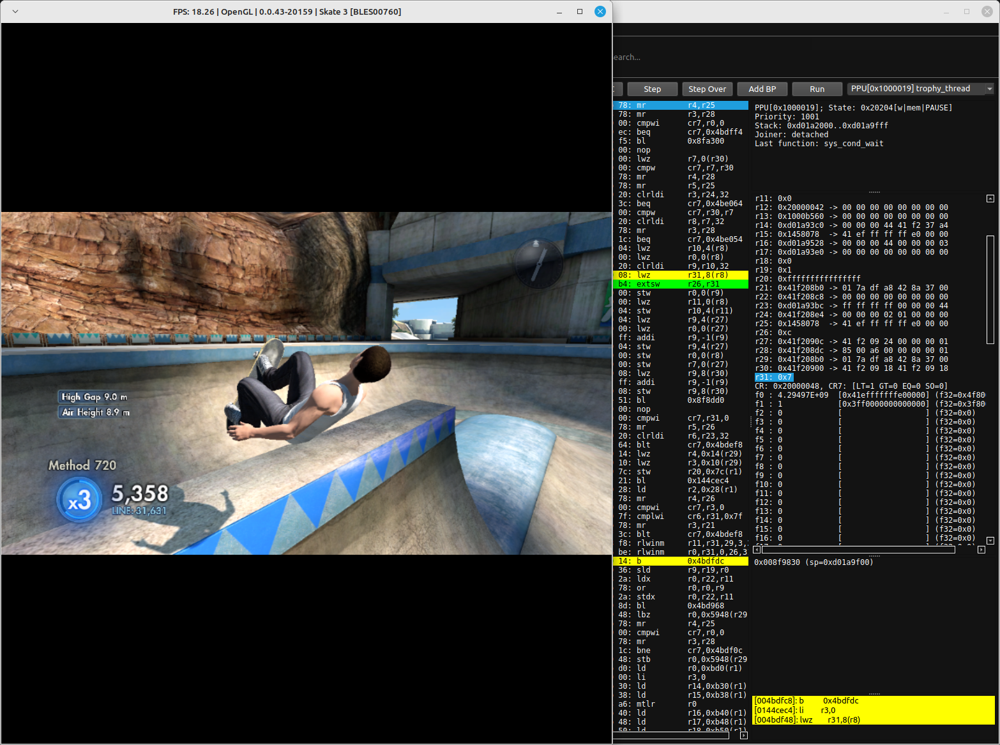
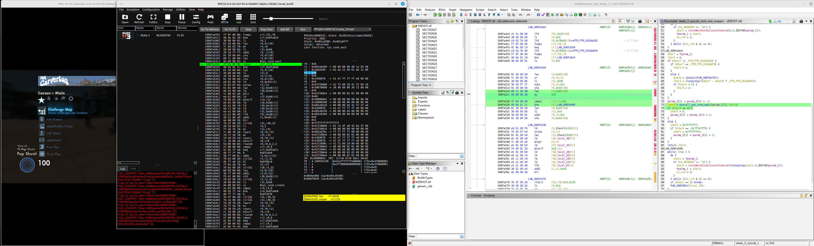
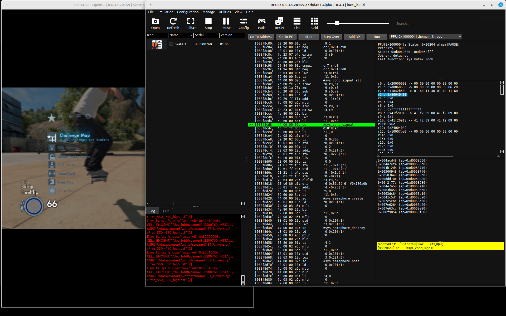
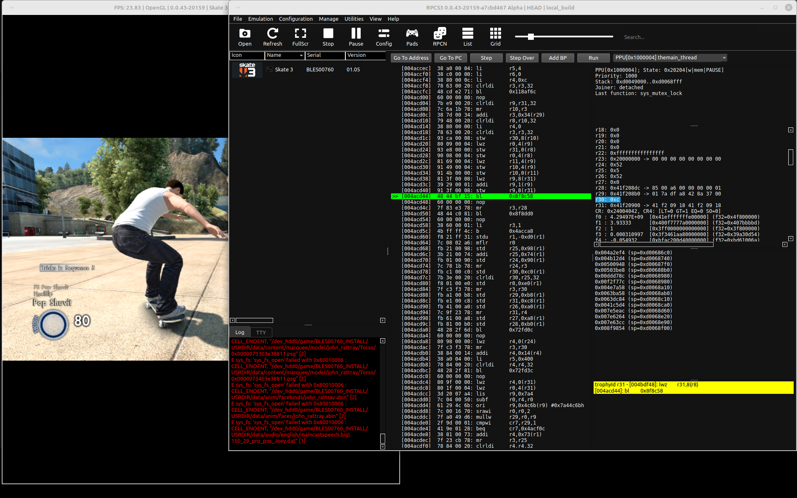

# Session 2026-10-20

[Session 2026-10-13](session_20261013.md#trophy-worker-thread) produced many inferences about the trophy worker thread, based on AI-assisted static analysis. This session validates those findings, this time at runtime with the RPCS3 debugger.

The RPCS3 patches created in the previous session sped up debugging immensely and made this validation practical.

## Approach

[Session 2026-10-13](session_20261013.md#trophy-worker-thread) showed through static analysis that the trophy worker thread is the only place that calls `sceNpTrophyUnlockTrophy`. The first runtime check is to find the trophy ID in the RPCS3 debugger, when a trophy unlocks. See [Trophy Details](../3_analysis_validation.md#trophy-details) for more details.

The goal is to find out where work is added for the trophy worker thread and how it is woken up to unlock a trophy.

Gone Viral is the actual target, but the analysis needs a different trophy that is easy to earn and repeatable. Mantastic Voyage fits: it needs only 3 manuals in a single sequence, so it can be unlocked over and over quickly. Starting from that trophy, the call graph is reverse engineered back to its origin, where the game evaluates the unlock condition, enqueues the trophy and wakes up the trophy worker thread.

The hope is that this reveals how the game unlocks trophies. That knowledge can then be used to find where in the `EBOOT.BIN` the Gone Viral conditions are evaluated, and to work out what kind of message from the server is required to unlock Gone Viral.

## Trophy Thread - Unlock a Trophy

A breakpoint at `0x004bdf4c` shows the ID of the trophy about to be unlocked in `r31`. The trophy ID comes from `TROPHY.TRP`. See [Trophy Details](../3_analysis_validation.md#trophy-details) for more details.

I started with Mantastic Voyage. At the breakpoint, `r31 = 0xC`, which is its trophy ID, as the screenshot below shows.



I also tried Trick Spammer. The screenshot below shows the same breakpoint with `r31 = 0x7`, which is its trophy ID.



## Trophy Thread - Wakeup Mechanism

Next, we look at how the trophy worker thread is woken up to unlock a trophy. In the debugger, the worker (`0x004bdb60`) is seen sleeping at `0x008fa51c`, the `sc` instruction for `sys_cond_wait` inside `FUN_008fa40c`.

### Thread Wakes up by Signal

A breakpoint at `0x008fa520` catches the wakeup. This is the instruction immediately after the `sc` (the `sys_cond_wait` syscall) at `0x008fa51c`. It executes the moment the worker wakes up, before anything else runs. At that point `r3` holds the syscall return code.

Steps taken:

- I tried to earn the Mantastic Voyage trophy and paused the game just before landing the trick.
- I then set the breakpoint at `0x008fa520`.
- When the worker woke, the breakpoint hit and showed `r3 = 0x0`.

A `sys_cond_wait` return code of 0 means the thread was woken by `sys_cond_signal` (or `sys_cond_signal_all`), not by a timeout.
The screenshot below shows the trophy worker thread hitting the breakpoint with `r3 = 0x0`.



### Finding the condvar Handle

The next question is which code calls `sys_cond_signal` on the trophy worker's condvar. The handle is stored at `ctx + 0x34 + 0x8` (i.e. `ctx + 0x3c`). To find the signaller, the cleanest approach is to read the actual condvar handle value at runtime and then watch for it.

With the worker paused at `0x008fa51c` (inside `sys_cond_wait`), `r28` is the base of the condvar struct (`r28 = 0x41f208e4`). The LV2 condvar handle is the 32-bit value at `r28 + 0x8`, which the code loads at `0x008fa518` with `lwz r3, 0x8(r28)`:

```
handle = *(r28 + 0x8) = *(0x41f208ec)
```

Debugger view of `r28`:
```
r28: 0x41f208e4 -> 00 00 00 02 01 00 00 00
```

Reading `r28 + 0x8` in the RPCS3 memory viewer gives the condvar handle `0x86049400`.

### Finding the Signal Caller

#### Breakpoint on the Signal Call and Compare the Handle

All `sys_cond_signal` calls in the binary go through a single wrapper `FUN_008f8c58`. A breakpoint at `0x008f8cd8` (the `syscall_sys_cond_signal` call inside `FUN_008f8c58`) fires on every signal. Each time it fires, check `r3`, which is the condvar handle being signalled. If `r3` equals the condvar handle found earlier (`0x86049400`), this is the call that wakes the trophy worker. The call stack at that moment shows the caller, which directly reveals which function signals the trophy worker's condvar.

#### Result

The breakpoint fired with `r3` matching the trophy worker's condvar handle from thread `PPU[0x1000004] themain_thread`:

```
PPU[0x1000004]; State: 0x20204[w|mem|PAUSE]
Priority: 1000
Stack: 0xd0049000..0xd0068fff
Joiner: detached
Last function: sys_mutsee ex_lock

r0 : 0x20000000 -> 00 00 00 00 00 00 00 00
r1 : 0xd0068630 -> 00 00 00 00 d0 06 86 c0
r2 : 0x1842b50  -> 01 4e 11 40 01 4e 11 60
r3 : 0x86049400
...
LR: 0x4acd48
```

The call site is at `0x004acd44` (`bl 0x008f8c58`) inside `_opd_FUN_004acbc8` and `r2 = 0x1842b50` is the TOC base of the calling thread.

The screenshot below shows the state at the breakpoint:



## The Main Thread - Signal Function

The previous steps showed that the trophy worker thread is woken by `_opd_FUN_004acbc8` which is called from a different thread called `themain_thread`. The goal is to find the origin of where the Mantastic Voyage trophy conditions are evaluated and how this signal function is called.

### Breakpoint

To see which trophy is being enqueued, set a breakpoint at `0x004acd44` (the `bl 0x008f8c58` inside `_opd_FUN_004acbc8`) and trigger a trophy. At that point `r30` holds the trophy ID.

### Result

State of `PPU[0x1000004] themain_thread` at the breakpoint:
```
r30: 0xc
...
LR: 0x4acd00
```

`r30 = 0xc` is the trophy ID of Mantastic Voyage. The screenshot below shows the state at the breakpoint:



The trophy ID is also visible at the function entry, so it can be followed from entry to signal call:

| Breakpoint | Register | Value | Meaning |
|---|---|---|---|
| `0x004acbc8` (function entry) | `r4` | `0xc` | `param_2` = trophy ID = Mantastic Voyage |
| `0x004acd44` (signal call) | `r30` | `0xc` | trophy ID still `0xc` at point of signal |

### Signal Function Pseudo-Code

```c
undefined4 _opd_FUN_004acbc8(int *param_1, int param_2 /*trophy ID*/)
{
    // 1. Shutdown guard: ctx+0x5948 — drop if manager shutting down.
    if (*(char *)(param_1 + 0x5948) == '\0') return 0;

    // 2. Pre-enqueue gate: vtable call (*param_1->vtable[0x30])(param_1, trophy ID).
    //    Returns 0 if trophy already in local unlock bitset → drop.
    if (vtable[0x30](param_1, param_2) != 0) return 0;

    // 3. Lock queue mutex at ctx+0xb.
    sys_mutex_lock(param_1 + 0xb);

    // 4. Dedup scan: walk pending queue at ctx+0x14.
    //    If trophy ID already queued → skip enqueue, just unlock and return.
    if (already_queued(param_1 + 0x14, param_2)) {
        sys_mutex_unlock(param_1 + 0xb);
        return 1;
    }

    // 5. Allocate 12-byte node from pool at ctx+0x17.
    node = alloc(param_1 + 0x17, 0xc, 4, 0);
    node[2] = param_2;              // Trophy ID stored at word [2].

    // 6. Link node into tail of queue at ctx+0x14/0x15, increment count at ctx+0x16.

    // 7. Signal the trophy thread.
    sys_cond_signal(param_1 + 0x34);

    // 8. Unlock mutex.
    sys_mutex_unlock(param_1 + 0xb);
    return 1;
}
```

## The Main Thread - Call Stack

Next, we continue further up the call stack. The RPCS3 debugger does not provide a call stack, so this has to be done manually: set a breakpoint, read `LR` to find the caller, go to that function, and repeat.

### Vtable Thunk

`_opd_FUN_004acbc8` is registered in the trophy manager vtable at `0x017adfd4`
(`+0x14` from vtable base `0x017adfc0`). It is called through a thunk:

```c
// _opd_FUN_01190130 @ 0x01190130
void _opd_FUN_01190130(longlong param_1) {
    _opd_FUN_004acbc8(param_1 + -8);  // adjust this ptr by -8
}
```

### Indirect Dispatch Wrapper

To find who calls `_opd_FUN_004acbc8`, set a breakpoint at its entry (`0x004acbc8`) and trigger a trophy. When the breakpoint fires, `LR` is the return address of the caller:

- `LR = 0x4a2ef4`
- The call instruction is the one before it, at `0x4a2ef0` (`LR - 4`).

`0x4a2ef0` is inside `FUN_004a2e70` (`0x004a2e70`). It is an indirect dispatch wrapper: it gets an object from a global singleton through vtable slot `0x28`, then calls vtable slot `0x8` of that object, passing on its own two parameters:

```c
undefined1 FUN_004a2e70(undefined4 param_1 /*trophy_id*/, undefined4 param_2) {
    piVar1 = (*global_singleton->vtable[0x28])(global_singleton); // get trophy mgr
    if (piVar1 != NULL)
        return piVar1->vtable[0x8](piVar1, param_1, param_2);     // _opd_FUN_004acbc8
    return 0;
}
```

### Central Trophy Request Function

The next step up the call stack is to find what calls `FUN_004a2e70`. `FUN_004b11d4` (`0x004b11d4`) is a caller: its decompilation ends in a call to `FUN_004a2e70(trophy ID, param_2)`, which is the trophy ID and second parameter that the wrapper above passes on.

A breakpoint at the entry of `FUN_004b11d4` hit while unlocking Mantastic Voyage and shows its arguments and caller:

- `r3 = 0x1bd48906e119a954`: the 64-bit trophy hash for Mantastic Voyage
- `r4 = 0x0`
- `LR = 0x500948`: the return address of its caller

`FUN_004b11d4` is called from 21 places across the codebase. It appears to be an entry point for trophy unlock requests. It takes a 64-bit hash as input and converts it to the trophy ID listed in `TROPHY.TRP`. Ultimately, it enqueues the work and wakes up the trophy worker thread.

```c
undefined1 FUN_004b11d4(undefined8 param_1 /*trophy_hash*/, undefined4 param_2) {
    // Look up trophy definition by 64-bit hash.
    // Resolve numeric trophy ID via FUN_004b10a0.
    // Call FUN_004a2e70(trophy ID, param_2).
}
```

### Trick Sequence Evaluation Function

`FUN_00500734` is a function that evaluates a trick sequence and calls `FUN_004b11d4` for Mantastic Voyage. Confirmed via `LR = 0x00500948` at a breakpoint.

It checks `*(char *)(piVar3 + 0x167e) > 2` — the manual count in the trick state struct must exceed 2 manuals in a sequence before dispatching:

```c
if (('\x02' < *(char *)((int)piVar3 + 0x167e)) &&
   (FUN_004b12ec(0x1bd48906e119a954) == '\0')) {
    FUN_004b11d4(0x1bd48906e119a954, 0);
}
```

All trophies evaluated in function `FUN_00500734`:

| Trophy Hash | Condition | Trophy |
|---|---|---|
| `0xb598d5bd5d16ec4f` | score > 9,999 | Blaow! |
| `0x2a9d5f12bc41ee19` | score > 29,999 | Trick Spammer |
| `0xe9c379e93fa2693f` | trick count > 2 | Objectifier (not sure) |
| `0xd127d95b8d349b72` | float threshold | possibly Extreme Grindage |
| `0x1bd48906e119a954` | 3+ manuals in a sequence | Mantastic Voyage |

## Call Stack for Mantastic Voyage

The previous sections walked up the call stack from the trophy worker thread, one `LR` at a time. This section puts the steps together into the full chain for Mantastic Voyage, from the code that evaluates the unlock condition down to the `sceNpTrophyUnlockTrophy` call.

```
FUN_00500734
  │  condition: player manual count at struct+0x167e > 2
  │  hash: 0x1bd48906e119a954
  │  r3 = 0x1bd48906e119a954 (at breakpoint)
  │  r4 = 0x0
  │
  ▼
FUN_004b11d4
  │  r3 = 0x1bd48906e119a954 (at breakpoint)
  │  r4 = 0x0
  │  resolves hash → trophy ID = 0xc
  │
  ▼
FUN_004a2e70
  │  routes through global singleton vtable
  │
  ▼
_opd_FUN_004acbc8
  │  r4 = 0xc (at breakpoint: param_2 = trophy ID)
  │  allocates node, writes node[2] = 0xc
  │  r30 = 0xc at signal call (at breakpoint 0x004acd44)
  │  sys_cond_signal(ctx + 0x34)
  │
  ▼
trophy_thread (0x004bdb60)
  │  r3 = 0x0 (at breakpoint 0x008fa520 → woken by signal)
  │  dequeues node and reads node[2] = 0xc
  │
  ▼
sceNpTrophyUnlockTrophy(ctx+0x10, ctx+0x14, 0xc, &platflag)
  │  r5 = 0xc (at breakpoint 0x0144cec4)
  │
  ▼
Trophy unlocked in PS3 system
```
