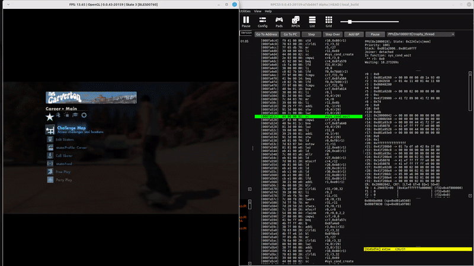

# Session 2026-10-22

[Session 2026-10-21](session_20261021.md#gone-viral-trophy-hash) found the Gone Viral trophy hash (`0x17e8ac1014ab97a5`) in memory and showed that `_opd_FUN_0046eb04` passes it to `FUN_004b11d4`. This session verifies at runtime that this hash really unlocks Gone Viral.

## Patch Gone Viral Hash into the Trick Sequence Evaluation

The trophy unlock path is already understood for Mantastic Voyage ([Session 2026-10-20](session_20261020.md#call-stack-for-mantastic-voyage)). Instead of trying to reach the Gone Viral conditions, the Mantastic Voyage hash in `FUN_00500734` is replaced with the Gone Viral hash using an RPCS3 [patch](../../rpcs3/imported_patch.yml#22-34). Then 3 manuals in a sequence should unlock Gone Viral instead.

Setup in RPCS3:

- Disable the other 2 debug patches and enable only the new patch.
- Boot the game and set a breakpoint at `0x004bdf4c`, which shows the trophy ID in `r31`.
- Do 3 manuals in a sequence, which would normally unlock Mantastic Voyage.

## Result

After the 3 manuals, the Gone Viral trophy unlocked. This confirms at runtime that `0x17e8ac1014ab97a5` is the correct trophy hash for Gone Viral.

