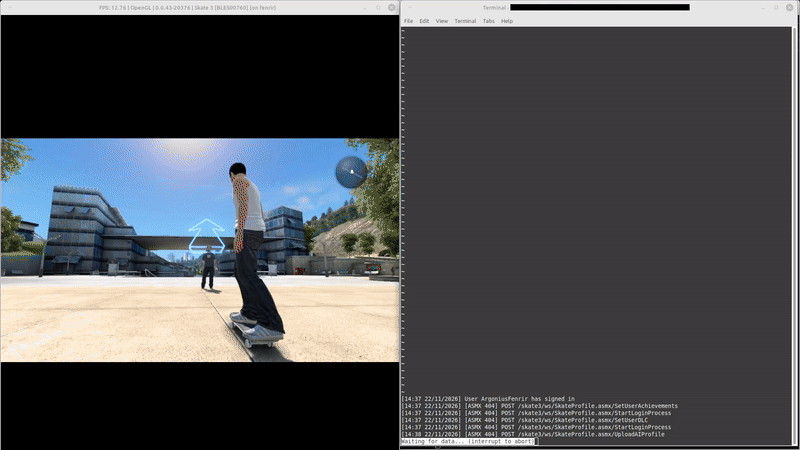

# Session 2026-11-22

[Session 2026-11-21](session_20261121.md) found that the game sends `POST /skate3/ws/SkateProfile.asmx/Infect` when the builder posts the class A event, and that the public [Skate3BlazeServer](https://github.com/skate6743/Skate3BlazeServer) answered `404`. In this session, we modify the custom server to answer that request and see whether Gone Viral unlocks.

## Setup

The [Skate3BlazeServer](https://github.com/skate6743/Skate3BlazeServer) was compiled locally with a patch (see section [Server Patch](#server-patch) below), and RPCS3 was pointed at the locally hosted instance. The `IP/Hosts switches` setting in RPCS3 was changed from the public server to localhost:

```
gosredirector.ea.com=127.0.0.1&&downloads.skate.online.ea.com=127.0.0.1
```

The RPCS3 patch [Skate3BlazeServer - No Sync Check](../../rpcs3/imported_patch.yml#34-43) as discussed in [session 2026-11-17](session_20261117.md#setup) was still applied. No other patch from `imported_patch.yml` was enabled, so none of the Gone Viral debug patches that change the trophy code were active.

## Server Patch

Both changes are in `Skate Custom Server/Servers/HTTP/HttpServer.cs`, in the `SkateReel.asmx` / `SkateProfile.asmx` action `switch`. See [this commit](https://github.com/ArgoniusFenrir/Skate3BlazeServer/commit/d55d405c8fc90ca4fffac54caf19a3928f01986f) for the diff.

- New `case "Infect":`. It reads the request body, writes one `[Infect] ...` line with method, path and body to `logs.txt`, then replies with a `BoolContainer` holding `true`. A second `[Infect] response: ...` line logs the status, content type and body.
- The `default` branch logs `[ASMX 404] <method> <path>` for debug reasons before returning `404`. Before this, rejected `.asmx` requests left no trace.

## Observations at Runtime

Server log while joining a freeskate session:

```
[14:40 22/11/2026] [Infect] POST /skate3/ws/SkateProfile.asmx/Infect body: platformId=2&userIds=1
[14:40 22/11/2026] [Infect] response: 200 text/xml body:
<BoolContainer>
  <value>true</value>
</BoolContainer>
```

- The game sent `POST /skate3/ws/SkateProfile.asmx/Infect` with the body `platformId=2&userIds=1` when joining a freeskate session.
- The server replied `200 text/xml` with `<BoolContainer>` and `<value>true</value>` (indented, no XML declaration).
- The Gone Viral trophy unlocked while joining the freeskate session.
- The `userIds` value was `6766` in the capture of [session 2026-11-21](session_20261121.md) and is `1` here. The cause was not investigated.

## Observations Through Static Analysis

- The type name `BoolContainer` is a string in the game binary at `0x014998b0`. It sits in a table of type-name strings with `IntegerContainer` (`0x01499878`), `LongContainer` (`0x01499890`), `StringContainer` (`0x014998a0`) and `ErrorContainer` (`0x014998c0`). The string is not a .NET or XML standard type.
- Before this session the server source did not contain `BoolContainer`. It already used `IntegerContainer`, `LongContainer` and `ContentInfoContainer` in the same `<Name><value>...</value></Name>` shape.

## Results

Answering `POST /skate3/ws/SkateProfile.asmx/Infect` with a `BoolContainer` holding `true` unlocked the Gone Viral trophy, without changing the game (except for [Skate3BlazeServer - No Sync Check](../../rpcs3/imported_patch.yml#34-43)).

The server patch answers `true` to every `Infect` request. It does not decide whether a player was actually infected. This reverse engineering effort was never meant to match the official EA implementation. Its goal was to make the unattainable Gone Viral trophy unlockable on real PS3 hardware.

The GIF below shows RPCS3 joining a freeskate lobby on the left, connected to a locally compiled and running instance of [Skate3BlazeServer](https://github.com/skate6743/Skate3BlazeServer) with the Infect patch applied. The server log is on the right. While the game joins the lobby, its `POST` request shows up in the log and the server answers it. A moment later, RPCS3 unlocks the Gone Viral trophy.


